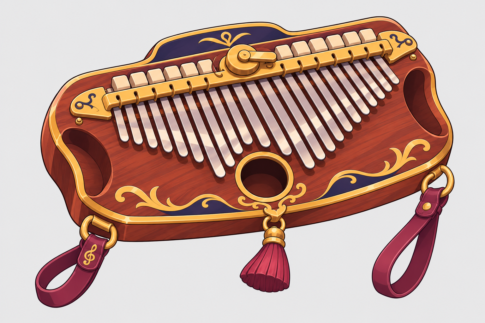
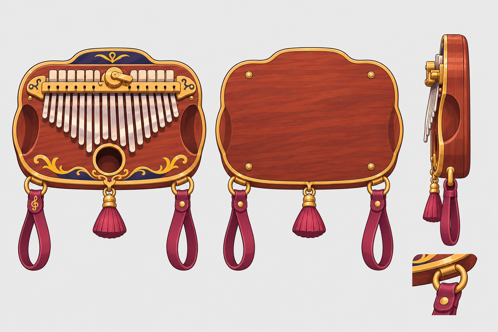

# SW02_Kalimba · 拇指琴建模任务书

> 将本文件与同目录两张 PNG 一起交给建模工具。本文件是待执行的制作任务，不代表已经完成模型。尺寸为本次建议的首版制作规格，不是从 AI 图片测出的现实尺寸；参考图负责外观，结构数量以文字为准。

## Production Brief

- Type：第一人称 Hero Prop，音律战斗乐器。
- Target：PC / Unity 6000.6.4f1 / URP 17.6，Generic 骨架。
- Style：02 复古动漫赛璐璐，清晰轮廓、克制装饰、暖木/象牙/金/午夜蓝/酒红。
- Poly Budget：LOD0 ≤ 10000 tris，LOD1 ≤ 5000，LOD2 ≤ 2000；总数含弓、带与活动件，不含检查用假手。
- Texture Budget：一组 2048×2048 BC/ORM/E，必要时加 N；最多2个材质槽。花纹走贴图，轮廓与可动件保留几何。
- Export：模型FBX + 单动作FBX + PNG + manifest.json + 可继续编辑的 .blend。
- Pivot：握持总根 root；以便携演奏位组装，不把原点自动移到地板。
- Animation：原地、机械/局部柔性动作，60fps；模型和动作的骨架路径必须完全相同。
- Scope：只制作 SW02_Kalimba 单一款，不增加皮肤、能力或全身角色。

### Active Skills / 模板来源

采用用户指定的 <BLENDER_REPO>/.claude/skills/ 下 blender-director 的 Production Brief 与 Reference Analysis 模板。后续建模依次使用：
blender-director → prop-artist + anime-style → uv-workflow / materials → asset-optimization / lod-pipeline → rigging / animation → collision-proxy / unity-export / qa-review。
参考规范为 references/asset-pipeline.md、reference-analysis-template.md、naming-conventions.md、polycount-budgets.md。下文 MCP 步骤是交给建模工具的执行计划，本轮没有运行 Blender 建模。

## 同目录建模参考图

[完整造型](reference_01_hero.png) · [结构多视图](reference_02_structure.png)





两张为 API 重新生成的干净背景参考；第二张引用第一张结果链式生成。不是严格标定的三视工程图，不能从像素直接推算米数，不能将整图当作模型贴图。图中视角间的遮挡差异、音舌/弦数量偏差、臆造细件按本任务书统一，并记入 validation.md。

## Reference Analysis

### 1. 主体、尺寸与轴向

- 游戏 ID：smg；资产 ID：SW02_Kalimba，二者映射写入 manifest。
- 主轮廓：浅厚度圆角木共鸣箱、中央音孔、左右两手拨片分区、金属音舌、压桥与侧握边。
- 首版尺寸（Unity绑定姿态 X宽/Y高/Z深）：X 0.25 × Y 0.055 × Z 0.19m，不含自由垂落腕带；演奏面朝 +Y，音舌自由端靠玩家（-Z）。
- 场景单位米；放置1.8m人体量尺与0.10m单位块，量尺不导出。
- Unity最终根 +Y向上、+Z为瞄准/发射方向、+X向右。演奏面方向按上文定义，不等同于发射方向。
- Blender +Z向上、-Y对应目标前方；导出后以实际Unity回读验证轴向，不能只凭参数猜测。

### 2. 轮廓层次与必须保留的特征

先主形体/厚度，再连接与活动缝，最后金边、浮雕和花纹。
音舌总数按文字固定17，生成图密集细条数量不是测量依据；固定端在压桥下、自由端可被拇指接触；背板、腕带锚点齐全。

### 3. 参考相机与第一人称检查

建立 CAM_SW02_Kalimba_Hero 与 EMPTY_SW02_Kalimba_CamTarget，先匹配主图三分之四机位再做细节；长焦/正交检查比例，不用广角掩盖结构错误。另建 Front / Back / Side 正交相机和 FP 相机。

FP初始相机位于原点面向+Z，将完整乐器置于画面下方：横向占屏约35–65%，不通过破坏米制比例来强行塞入画面。中心宽20%×高20%为主要瞄准留白区，大块实体不得持续覆盖。常规FOV从60°开始，同时检查本枪瞄准配置 60°、16:9与21:9。相机参数不可烘焙进武器骨架。

仅用简单假手/前臂检查握持、手指接触和行程；归 PreviewOnly，不随每把武器导出重复的人物手臂。正式玩家手部资产后续共用；当前交付必须给出可驱动手部IK的挂点。

### 4. 灯光、颜色与材质

主光柔和左上、弱补光看清凹槽；浅灰背景，避免高光淹没弦和金属拨片。
以下为风格建议色，不声称经过图像精确取样：

| 用途 | 建议色 |
|---|---|
| 木色 | #914C35 |
| 象牙白 | #EAD9B5 |
| 暖金 | #C39A50 |
| 午夜蓝 | #263349 |
| 酒红 | #792C3D |
| 共鸣青 | #6ED3D5 |
| 暗线 | #302A35 |

BC不烘焙舞台灯、攻击光和外描边；木/漆/金属/布用粗糙度区分。发光仅为E遮罩区域，不对共享结构材质打发光关键帧。不把 Blender Shader-to-RGB 网络误当成可运行 Unity 材质。以现有赛璐璐着色器观感复核。

### 5. 功能分件

| 网格名称示例 | 几何与功能 | 绑定骨骼 |
|---|---|---|
| SM_SW02_Kalimba_Body_LOD0 | 封闭胡桃木箱体、圆音孔及内部暗腔 | body |
| SM_SW02_Kalimba_Tines_LOD0 | 17 根音舌：左8/中1/右8，中央长两侧短，自由端朝玩家 | tine_01..17 |
| SM_SW02_Kalimba_Bridge_LOD0 | 压住音舌固定端的黄铜桥，不能让音舌悬浮 | body |
| SM_SW02_Kalimba_TuningCam_LOD0 | 中央调律偏心轮、轴和机械止挡 | tuning_cam |
| SM_SW02_Kalimba_SideGrips_LOD0 | 双侧凹握边，留出手指厚度 | body |
| SM_SW02_Kalimba_WristStraps_LOD0 | 左右腕带、扣环和真实锚点 | strap_L / strap_R |

固定件可按材质合并降低draw call，活动件保持独立驱动。LOD1/2保持相同部件前缀、骨架路径，替换末尾LOD编号。合并必须保留蒙皮权重与绑定矩阵。

## 骨架、手部与输出挂点

- 骨架 ARM_SW02_Kalimba，单根 root；应用对象变换，绑定姿态骨骼scale=(1,1,1)，不允许负缩放。
- 层级：root → body；body → tuning_cam、tine_01..tine_17、strap_L、strap_R。单根音舌根部固定，末端微弯，总骨骼建议 ≤32。
- 握持/发射关系：双手托侧边与背板，两只拇指接触音舌自由端；Socket_Thumb_L/R 在演奏区。输出点在远离玩家的桥上方朝 +Z。
- 必备 Socket_Grip_L、Socket_Grip_R、Socket_Output、Socket_Aim、Socket_Retune、Socket_Stow；有拇指/手掌/拨弦需求再加 Socket_Thumb_L/R、Socket_Palm_R 或 Socket_Finger_R。
- Socket_Output与Socket_Aim的本地+Z朝发射方向、+Y朝上；非专用瞄准款也须提供稳定对准点。可动手部挂点随对应部件运动。
- 骨骼建议≤64含挂点；每顶点最多4权重并归一。刚性木/金属件使用明确单骨权重，不能全模型自动权重后直接交付。
- 约束/驱动器可保留在源.blend编辑，FBX必须烘焙为实际位置/旋转曲线；非变形挂点不得被导出器过滤。
- 不烘焙相机震动或世界根位移；局部演奏反馈与武器总后座分开，避免叠加现有 WeaponMotion。
- 当前 WeaponMotion 是通用枪械表现，不能自动识别本包动画。后续引擎集成要单独绑定Animator和手部IK，本任务不能声称已自动接入。

## 现有玩法映射与动作

保留现有配置：10槽、容量50、基础击发间隔0.075s、每次读取1个子弹配件、调律/换弹1.7s。仅改变视觉包装，不新增蓄力、节奏输入或伤害事件。

动作60fps；表内末帧为长度计算终点，循环首末姿态一致。秒数为权威，Unity回读误差≤1/60s。root位置/旋转全程固定，无骨骼缩放曲线。

| Action / 文件前缀 | 时长 / 帧范围 | 循环 | 说明 |
|---|---|---|---|
| AN_SW02_Kalimba_Idle | 2.00s / 0–120 | 是 | 低幅待机，root固定 |
| AN_SW02_Kalimba_Move | 1.00s / 0–60 | 是 | 局部轻惯性，可由引擎总摆动替代 |
| AN_SW02_Kalimba_Equip | 0.15s / 0–9 | 否 | 展开至待机，换枪后半段 |
| AN_SW02_Kalimba_Unequip | 0.15s / 0–9 | 否 | 局部件收纳，换枪前半段 |
| AN_SW02_Kalimba_FireLoop | 0.30s / 0–18 | 是 | 双拇指交替拨片，左右音舌分组微振动，自由端振幅 1–2mm；不能像门板一样翻动整根音舌。 |
| AN_SW02_Kalimba_FireRecover | 0.15s / 0–9 | 否 | 快速停止演奏后回Idle，不额外发弹 |
| AN_SW02_Kalimba_Reload | 1.70s / 0–102 | 否 | 音舌停止；中央调律轮转至维护角并回位；末段试音，所有音舌回到静止位置。 |
| AN_SW02_Kalimba_Inspect | 3.00s / 0–180 | 否 | 展示可动件/背面结构，root固定 |

- 高射速用持续演奏循环承载外观；弹丸时间由GunRuntime驱动，不用每发重播一个长动作。停止射击平滑进入FireRecover。
- Reload按0..1可定位，支持真实换弹时长、暂停、打断；结束部件复位。空仓不要求额外装填规则。
- normalizedMarkers只描述视觉接触/抽出/插回节点；不得嵌入直接发弹或扣血的AnimationEvent。
- Equip/Unequip各0.15s，总计对应现有0.3s换枪时段；可视轨迹留给引擎总根，FBX只驱动内部件。

## 集合、UV、清理与碰撞

建立 COL_SW02_Kalimba_Reference / Blockout / Geo_LOD0 / Geo_LOD1 / Geo_LOD2 / Rig / Collision / Preview / Export。
对象分别用 SM_/ARM_/AN_/MAT_/T_/CAM_/LGT_ 前缀，ASCII命名、下划线、每名<64字符。

UV 0–1、密度尽量一致；近景握持面、按键/弦端优先分配。2048图集岛间距≥8px，不镜像文字或非对称装饰。
BC=sRGB，ORM=线性（R=AO、G=Roughness、B=Metallic），E=线性遮罩；可选N采用OpenGL +Y，注明Unity NormalMap导入类型。
导出前固定三角化，清掉孤立点、重复面和退化三角；凹腔/透孔保留实际厚壁，琴弦、音舌和风箱不能用无厚度相交面冒充完整部件。分别测试各LOD法线、UV、材质与权重。

第一人称武器不参与玩家/子弹实体阻挡；仅交付简化拾取代理 SM_SW02_Kalimba_Pickup_COL，独立Collision集合和FBX，作为可选入库项。不能把渲染网格直接当高面数碰撞体。

## 命名、目录与导出

工作根建议 <BLENDER_REPO>/MusicWeapons/SW02_Kalimba/。
交付根 <GAME:S>/_Inbox/weapons/MusicWeapons_v001/SW02_Kalimba/。不要直接写Assets，不把整个交付目录拖入Unity。

```text
SW02_Kalimba/
  Source/SW02_Kalimba.blend
  Exports/SW02_Kalimba_Model.fbx
  Animations/AN_SW02_Kalimba_Idle.fbx
  Animations/AN_SW02_Kalimba_<Action>.fbx
  Textures/T_SW02_Kalimba_BC.png
  Textures/T_SW02_Kalimba_ORM.png
  Textures/T_SW02_Kalimba_E.png
  Textures/T_SW02_Kalimba_N.png          # 仅需要时
  Collision/SW02_Kalimba_Collision.fbx
  Preview/Front.png
  Preview/Back.png
  Preview/Side.png
  Preview/Hero.png
  Preview/FP_Idle.png
  Preview/FP_Fire.png
  Preview/FP_Reload.png
  Preview/AnimationReview.mp4
  manifest.json
  validation.md
```

模型FBX含同一骨架、三档LOD网格、公共挂点，不含动作、灯光、相机、量尺或检查假手。
每个动画FBX只含相同骨架和一个指定动作；不额外插根，不更改骨架/挂点路径，不混入其他NLA动作。

FBX参数基线：Scale=1；单位米；Forward=-Z、Up=Y；Apply Unit开；Add Leaf Bones关；Bake Space Transform关；仅选定对象；单动作导出。非变形挂点必须显式导出，不能被Only Deform Bones丢掉。以Unity回读结果为准，保留FBX导入坐标转换，不在运行时凭猜测叠90°旋转。

manifest.json至少包含：
- schemaVersion、assetId=SW02_Kalimba、gunId=smg、revision、units=m、轴向和实际导出参数；
- 主体/附件尺寸、rest及活动极限bbox、单位块回读记录；
- 各LOD名称/三角数/材质、骨骼路径/绑定矩阵、全部挂点的父骨骼与变换；
- 每动作state/file/fps=60/duration/loop/normalizedMarkers/rootMotion=false；
- 贴图分辨率/色彩空间/通道；每个必需输入文件的相对路径、类型、SHA-256；
- 碰撞标记optional；Source、Preview、报告不进入引擎输入白名单；
- validationStatus逐项pass/fail/degraded与未决问题；没验证不能写pass。

后续武器专用入库清单将资源分类至Model/Animation/Material/Texture/Prefab，保留GUID；不可复用敌人资产ID、不可依赖外部建模目录运行。

## Pipeline Phases / MCP Execution Plan

1. 输出并补全本Brief与Reference Analysis；已有场景先快照，禁止覆盖无关资产。
2. 检查Blender MCP，创建上述COL_、米制单位、量尺与参考相机。
3. 白模主形 → 对照相机 → FP握持与中心留白；通过后再补连接/活动缝。
4. 分件精修、清理拓扑/法线、稳定三角化；拓扑修改前保存版本。
5. UV → 材质 → 中性光和项目风格对照；有差异列表再修正，最多三轮。
6. 三档LOD → 绑定 → 极限姿态 → 所有动作；每阶段查询实际场景数据。
7. 独立碰撞 → 白名单导出 → 新场景回读FBX → Unity检查。
8. 交付下面的量化记录，未完成项写degraded，不把计划当已验收。

## 交付验收

- [ ] 轮廓、功能分件与参考匹配；视角矛盾按文字统一并记录。
- [ ] 用世界坐标顶点求bbox，静止尺寸相对本规格偏差≤2%；不能只读对象dimensions。
- [ ] LOD面数≤10000/5000/2000；每档UV、法线、权重和材质完整。
- [ ] 无退化三角、孤立点、翻面；合法开孔/装配缝有记录，自交/壁厚未查不能写pass。
- [ ] 最大活动幅度和Reload 0/25/50/75/100%不穿插、不拉面、不掉部件。
- [ ] FBX回读骨架、绑定姿态与挂点相同；逐帧采样全部动作，无根位移/缩放曲线。
- [ ] 循环端点位置误差<0.1mm、角度<0.1°；非循环结尾回到定义的Idle或收纳姿态。
- [ ] FP待机/射击/调律在常规及瞄准FOV看清演奏，不以实体长期遮中心。
- [ ] 材质真正使用BC/ORM/E，不缺贴图，不依赖Blender专属节点。
- [ ] 预览、manifest、哈希、验证报告齐全；.blend可编辑，FBX含真实网格与动作。
